# Portail SMS pour VoIP.ms

Une interface web moderne et auto-hébergée pour les textos (SMS/MMS) de vos numéros [VoIP.ms](https://voip.ms), dans l'esprit de Google Messages pour le Web.

*[English version](README.md)*

**Première fois que vous hébergez une application?** Le [guide d'installation pas à pas](docs/install.fr.md) part de zéro : ce qu'il vous faut, puis chaque clic, sur un hébergement cPanel ou avec Docker.

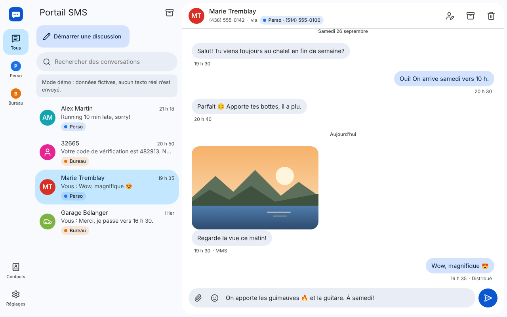

- **Tous vos numéros au même endroit.** Un menu latéral (des pastilles sur mobile) bascule entre « tous les numéros » et chaque DID. Donnez un nom et une couleur à chaque numéro ; chaque conversation indique à quel numéro elle appartient et les réponses partent toujours de ce numéro.
- **Réception vérifiée ou annoncée.** Le serveur interroge VoIP.ms (toutes les 10 s quand l'application est ouverte dans un navigateur, toutes les 60 s sinon), sans rien exposer sur Internet ; ou, quand le portail est joignable en HTTPS, VoIP.ms l'appelle dès qu'un texto arrive. Les messages reçus pendant un arrêt du serveur sont récupérés au redémarrage.
- **SMS ou MMS, automatiquement.** VoIP.ms compte sa limite de 160 caractères en *octets* (une lettre accentuée compte pour 2, un émoji pour 4). La zone de saisie affiche le compte et passe en MMS au besoin, ou dès qu'un fichier est joint.
- **Pièces jointes.** Photos, vidéos, sons et vCard (3 par message) ; les grosses photos sont redimensionnées dans le navigateur pour respecter la limite de 1,2 Mo de VoIP.ms. Les médias reçus sont téléchargés et conservés localement. Les messages vocaux, y compris les fichiers AMR qu'envoient les téléphones, se lisent dans un lecteur qui affiche leur forme d'onde.
- **Assistant de configuration.** Il explique comment activer l'API, affiche l'adresse IP exacte à autoriser, teste la connexion, liste vos numéros et importe l'historique.
- **Notifications push**, même quand l'application est fermée ou le téléphone verrouillé, sur chaque appareil où vous les activez.
- **Archivage** des conversations terminées ; elles reviennent dès qu'un nouveau texto arrive. **Suppression** de messages ou de conversations entières, dans le portail seulement ou chez VoIP.ms aussi.
- **Contacts** avec import vCard (Google Contacts, iCloud, Android…), sélecteur d'émojis, recherche qui ignore les accents (« belanger » trouve « Bélanger »), thèmes clair et sombre, français et anglais, installable comme une application sur téléphone.
- **Docker ou hébergement mutualisé.** Un seul conteneur, ou un hébergement web PHP ordinaire (cPanel) avec une tâche cron : le même serveur dans les deux cas. Voir [Hébergement mutualisé](#hébergement-mutualisé-cpanel).

## Visite guidée

*Toutes les captures viennent du mode démo (`DEMO_MODE=true`) : les numéros, les noms et les messages sont fictifs.*

### Une boîte de réception, plusieurs numéros

Le menu de gauche liste vos numéros VoIP.ms. « Tous » regroupe toutes les conversations, avec une pastille de couleur qui indique le numéro de chacune ; choisir un numéro n'affiche que ses conversations. Contacts et Réglages sont en bas.

| Tous les numéros | Seulement le numéro « Bureau » |
| --- | --- |
| 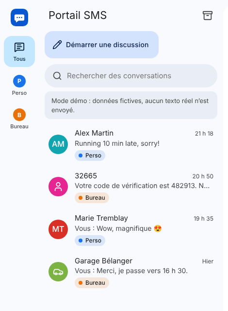 | 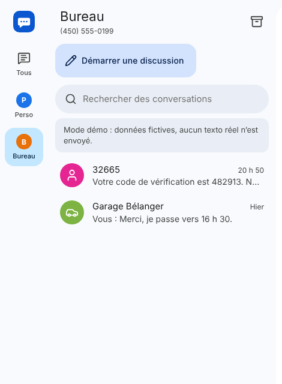 |

### SMS ou MMS : la zone de saisie décide

Tant que le texte tient dans 160 octets, il part en SMS et le compteur indique la place restante :


Un texte plus long, ou un fichier, le fait passer en MMS (jusqu'à 2048 octets). La pastille l'annonce avant l'envoi ; le message n'est jamais découpé en plusieurs SMS.


### Émojis

Le bouton en forme de bonhomme sourire ouvre un sélecteur au-dessus de la zone de saisie, avec vos émojis récents en premier. Il reste ouvert pour en ajouter plusieurs d'affilée et les insère à l'endroit du curseur.

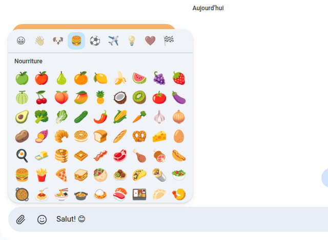

### Démarrer une discussion

Tapez un nom ou un numéro : les contacts sont suggérés au fil de la frappe. Avec plusieurs numéros, choisissez celui d'où part le texto. Si une conversation existe déjà avec cette personne sur ce numéro, vous y êtes amené.

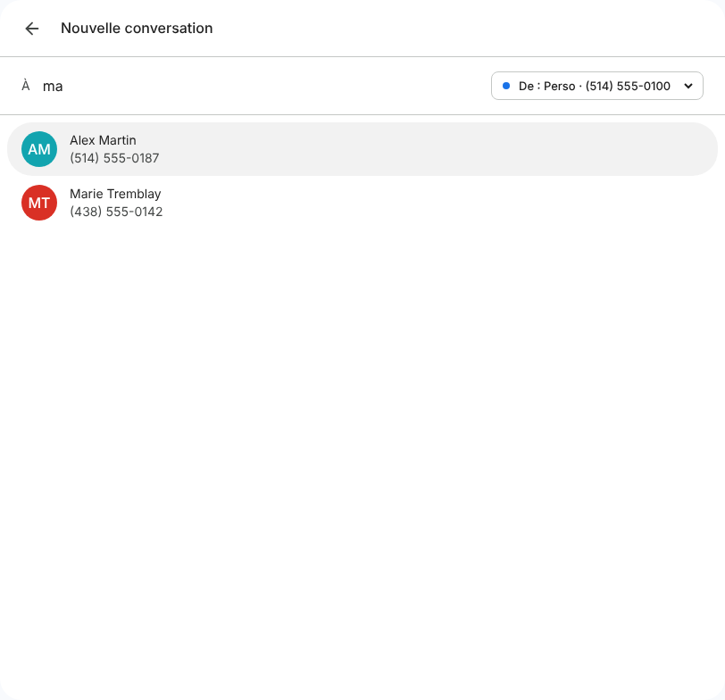

### Assistant de configuration

Au premier lancement, l'assistant vérifie les identifiants, affiche l'adresse IP que voit VoIP.ms (à ajouter à sa liste blanche), puis liste vos numéros pour les choisir, les nommer et leur donner une couleur. Activer un numéro dont le SMS est désactivé l'active dans votre compte VoIP.ms ; la ligne le dit avant. Il demande ensuite comment les nouveaux textos doivent arriver au portail (voir [Réception des textos](#réception-des-textos)). D'autres comptes VoIP.ms, un par client par exemple, s'ajoutent ensuite dans *Réglages* → *Comptes VoIP.ms*, avec les mêmes étapes.

| Autoriser l'adresse IP | Choisir ses numéros |
| --- | --- |
| 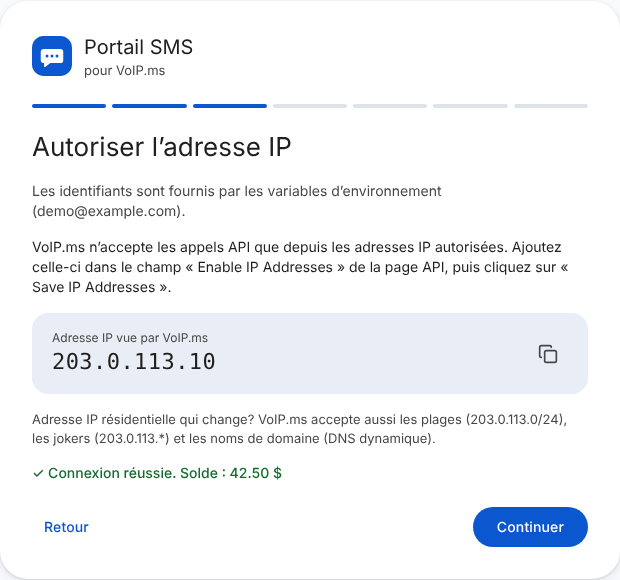 | 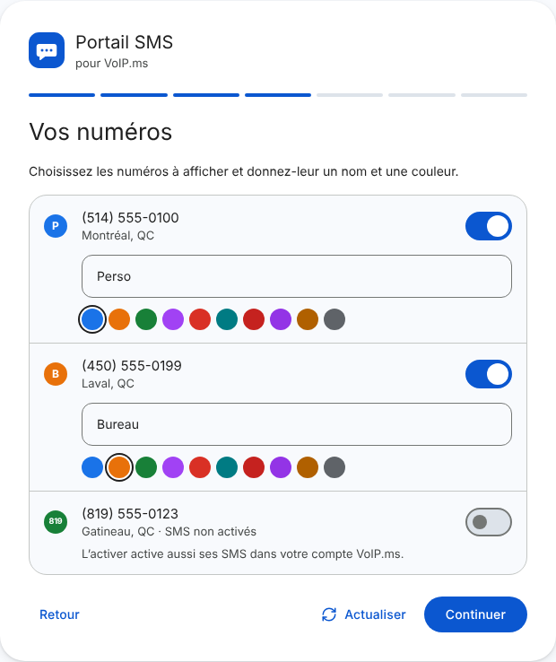 |

### Contacts

Les contacts sont enregistrés sur le serveur : tous les navigateurs voient les mêmes noms. Ajoutez-les à la main ou importez un fichier `.vcf` exporté de Google Contacts, d'iCloud ou de votre téléphone. Chacun peut avoir sa couleur d'avatar, et une icône à la place de ses initiales (maison, travail, famille, auto…) ; les numéros se mettent en forme pendant la saisie.

Pour en supprimer plusieurs d'un coup, touchez *Sélectionner*, cochez des contacts ou *Tout sélectionner* (après une recherche : tous ceux qu'elle a trouvés), puis *Supprimer* ; leurs conversations restent. Juste après un import, *Annuler* retire les contacts ajoutés, si le mauvais fichier est passé.

Avec plusieurs numéros, chaque contact appartient à un carnet : celui de tous les numéros, ou ceux de certains numéros seulement (un même téléphone peut alors être un contact différent sur chacun). En mode Équipe, chacun a aussi un carnet personnel que lui seul voit, dont les noms passent en premier dans ses conversations.

| Liste des contacts | Modifier un contact |
| --- | --- |
| 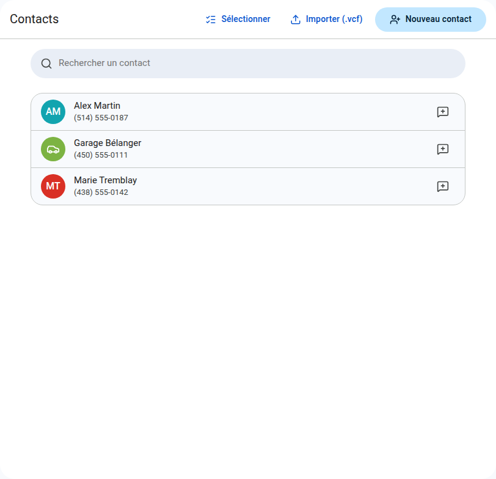 | 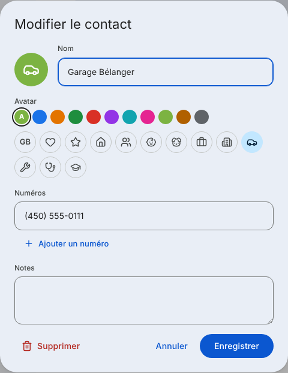 |

### Archives

Le bouton d'archivage, dans l'en-tête d'une conversation, la range (avec *Annuler*) ; l'icône de boîte au-dessus de la liste ouvre les archives. Un nouveau texto, reçu ou envoyé, ramène la conversation dans la liste principale. La recherche de la liste principale fouille aussi les conversations archivées et les signale.

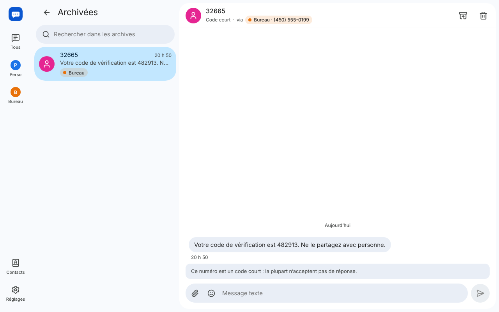

### Suppression

Touchez un message pour afficher son bouton *Supprimer* ; la corbeille dans l'en-tête d'une conversation la supprime au complet. Les textos supprimés quittent le portail pour de bon, sur tous les appareils : les vérifications de VoIP.ms ne les ramènent pas. VoIP.ms en garde une copie dans l'historique de votre compte, sauf si vous cochez *Supprimer aussi chez VoIP.ms*, qui l'efface là aussi, définitivement (le portail s'en charge en arrière-plan, un message à la fois). Un nouveau texto ramène une conversation supprimée, avec ce texto seulement.

### Notifications push

Activez-les dans les Réglages, sur chaque appareil : téléphone, ordinateur, tablette. Elles arrivent même quand aucun onglet n'est ouvert et évitent l'appareil où l'application est déjà à l'écran. Une fois l'application installée, son icône affiche aussi le nombre de textos non lus (iPhone, iPad, Windows, macOS ; Android affiche une pastille). Voir [Mettre en place les notifications push](#mettre-en-place-les-notifications-push) pour les prérequis.

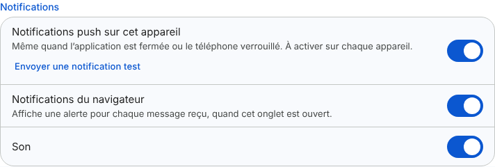

### Réception des textos

Par défaut, le portail interroge VoIP.ms à intervalles réguliers, ce qui fonctionne partout, même sur un réseau maison sans rien d'ouvert sur Internet. Quand le portail est joignable en HTTPS (toujours le cas sur un hébergement mutualisé ; avec Docker, réglez `PUBLIC_URL`), choisissez *Instantanée, par webhook VoIP.ms* dans l'assistant ou dans *Réglages* → *Réception des textos* : le portail règle lui-même le « SMS/MMS URL Callback » de chaque numéro chez VoIP.ms, et VoIP.ms appelle alors le portail dès qu'un de vos numéros reçoit un texto.

- Un numéro qui envoie déjà ses textos à une autre adresse (un CRM, une autre application) la garde, sauf si vous choisissez *Remplacer* ; revenir à la vérification régulière la lui rend.
- Un appel de VoIP.ms ne fait que déclencher une vérification immédiate de VoIP.ms : un appel qui ne viendrait pas de VoIP.ms ne peut donc pas ajouter de faux texto. Son adresse contient tout de même un secret.
- Une vérification a encore lieu toutes les 15 minutes : VoIP.ms n'appelle que pour les textos que reçoivent vos numéros, pas pour ceux envoyés depuis d'autres applications, et un appel peut se perdre pendant un arrêt du serveur.

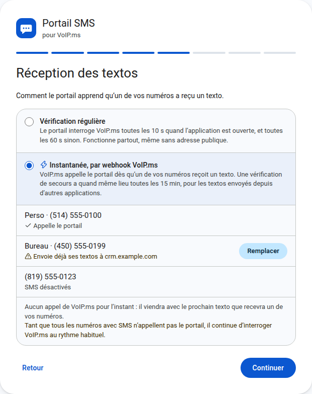

### Réglages

Renommez ou recolorez vos numéros, désactivez ceux que vous n'utilisez pas, synchronisez maintenant ou importez l'historique plus ancien, testez la connexion à VoIP.ms et choisissez les notifications, le thème et la langue.

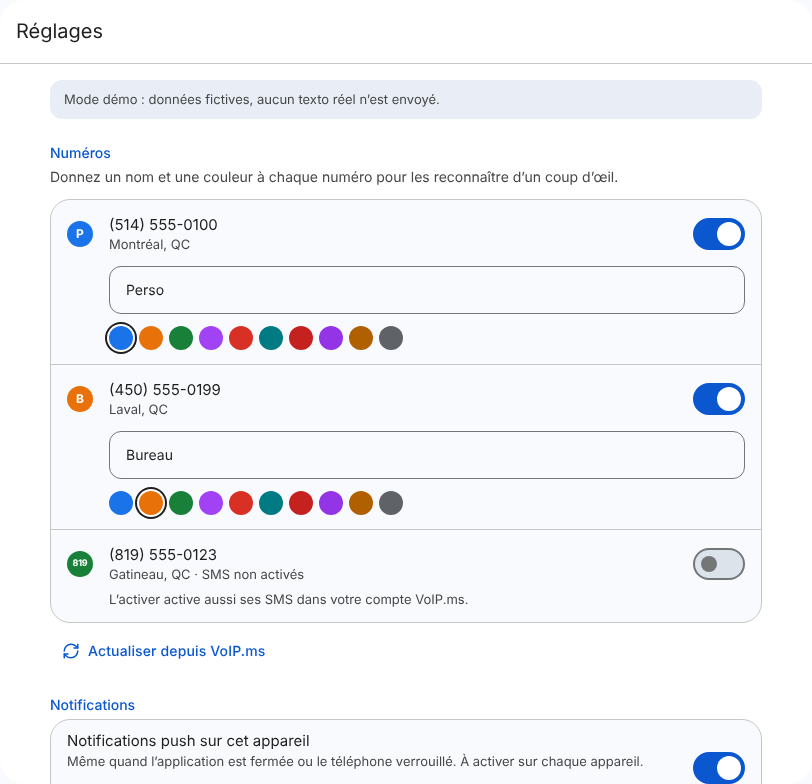

### Mode Équipe

Pour un bureau ou une famille, où plusieurs personnes répondent aux textos. Le propriétaire l'active dans *Réglages* → *Mode Équipe* en créant le premier administrateur, pour de bon. Chacun se connecte ensuite avec son propre courriel et son mot de passe. Les administrateurs ajoutent les utilisateurs et choisissent les numéros avec lesquels chacun texte, en lecture seule ou avec l'envoi; ils donnent un nouveau mot de passe à qui a oublié le sien, et suspendent ou suppriment un compte. Un utilisateur ne voit que les conversations et les notifications de ses numéros, et ses propres réglages. Chaque texto envoyé du portail indique qui l'a envoyé. Pour chaque numéro, les administrateurs choisissent si tous partagent ce qui est lu et archivé (par défaut) ou si chacun garde le sien, dans *Réglages* → *Numéros*; chacun peut aussi masquer un numéro pour lui seul, ou couper ses notifications, dans *Réglages* → *Mes numéros*. Chacun voit les navigateurs connectés à son compte et peut en déconnecter n'importe lequel, dans *Réglages* → *Mon compte*, et les administrateurs voient qui s'est connecté et ce qui a changé dans *Réglages* → *Journal d'activité*. `APP_PASSWORD` ouvre toujours le portail en propriétaire (*Connexion du propriétaire*), pour quand aucun administrateur ne le peut.

### Sur téléphone, et dans le noir

L'interface s'adapte aux petits écrans (les numéros deviennent des pastilles de filtre). Sur téléphone, un bandeau propose d'installer l'application sur l'écran d'accueil, puis d'activer les notifications. Le thème sombre suit celui du système ou peut être imposé.

| Conversations | Une conversation |
| --- | --- |
| 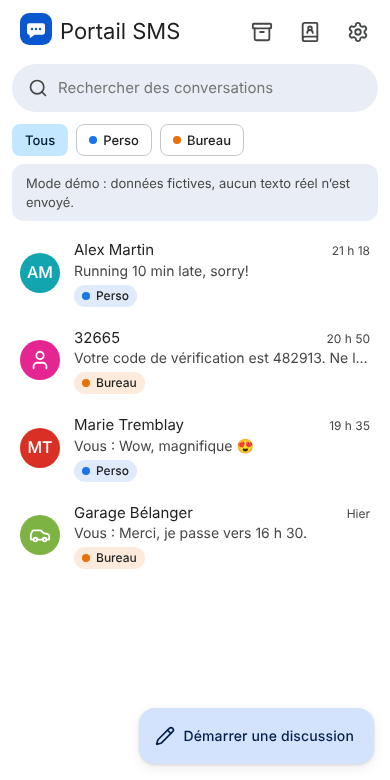 |  |

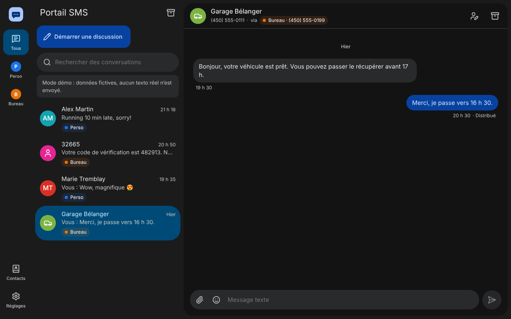

## Démarrage rapide (Docker)

Jamais utilisé Docker? Le [guide pas à pas](docs/install.fr.md#2b-installer-avec-docker) part du début.

```bash
git clone https://github.com/dansleboby/voip-ms-sms-portal.git
cd voip-ms-sms-portal
cp .env.example .env        # puis définissez APP_PASSWORD
docker compose up -d
```

Ouvrez <http://localhost:8080>, connectez-vous avec `APP_PASSWORD` et suivez l'assistant. Les données (base SQLite et médias) sont dans `./data` ; le conteneur rend ce dossier accessible en écriture à l'utilisateur de l'application au démarrage (voir `PUID`/`PGID`).

Compose utilise l'image publiée avec chaque [version](https://github.com/dansleboby/voip-ms-sms-portal/releases) (`ghcr.io/dansleboby/voip-ms-sms-portal`, pour x86 et ARM), et la construit à partir du dossier s'il ne peut pas la télécharger ; `docker compose up -d --build` la construit toujours à partir du code source.

**Mises à jour.** *Réglages* → *Mises à jour* indique quand une nouvelle version sort, avec ce qui change. Ensuite, là où se trouve `docker-compose.yml` : `docker compose pull && docker compose up -d`. Vos données restent dans `./data`. (Un conteneur ne peut pas remplacer sa propre image : celui-ci ne se met donc pas à jour lui-même.)

Pour faire le tour avant de brancher votre compte : `DEMO_MODE=true` affiche des numéros et des conversations fictifs, avec une réponse automatique, sans envoyer de vrais textos.

## Hébergement mutualisé (cPanel)

La même application fonctionne sur un hébergement web PHP ordinaire, sans Docker : le serveur est le même que celui de l'image Docker, et une tâche cron vérifie VoIP.ms quand l'application est fermée.

**Il faut** PHP 8.4 ou plus récent avec `pdo_sqlite`, `openssl`, `curl` et `mbstring` (activés par défaut dans cPanel ; la version se choisit dans *MultiPHP Manager*), un sous-domaine en HTTPS et les tâches cron. Les étapes ci-dessous en sont la version courte; le [guide pas à pas](docs/install.fr.md#2a-installer-sur-un-hébergement-cpanel) donne chaque clic.

1. Prenez `sms-portal-cpanel-<version>.zip`, joint à chaque [version publiée](https://github.com/dansleboby/voip-ms-sms-portal/releases) (ou construisez-le : `npm run build:cpanel`), et décompressez-le dans votre dossier personnel (cPanel → *Gestionnaire de fichiers* → *Charger*, puis *Extraire*). Vous obtenez deux dossiers côte à côte : `sms-portal/`, le serveur avec ses réglages et ses données, jamais servi, et `sms-portal-site/`, ce que le navigateur charge.
2. Créez le sous-domaine (cPanel → *Domaines* → *Créer un nouveau domaine*) avec `sms-portal-site` comme racine de document, et vérifiez qu'il est en HTTPS (cPanel → *État SSL/TLS* → *Exécuter AutoSSL*). Laissez les deux dossiers côte à côte : si chaque page répond *Forbidden*, la racine est `sms-portal` ou un dossier à l'intérieur, ou bien le serveur web ne peut pas lire les fichiers du site (il leur faut les permissions 644, et 755 pour les dossiers).
3. Dans `sms-portal/`, copiez `config.sample.php` en `config.php` et réglez `APP_PASSWORD`. Les autres réglages sont ceux du [tableau ci-dessous](#configuration), sauf ceux propres à Docker (`PORT`, `TRUST_PROXY`, `PUID`/`PGID`).
4. Ouvrez le sous-domaine, connectez-vous et suivez l'assistant. Sa dernière étape donne la tâche cron à ajouter (cPanel → *Tâches Cron*), chaque minute, par exemple `/usr/local/bin/php /home/vous/sms-portal/cron.php`, et voit quand elle démarre ; vous pouvez la passer, mais les textos et les notifications n'arrivent alors que quand l'application est ouverte. Les *Réglages* affichent aussi la ligne, et si la tâche tourne.

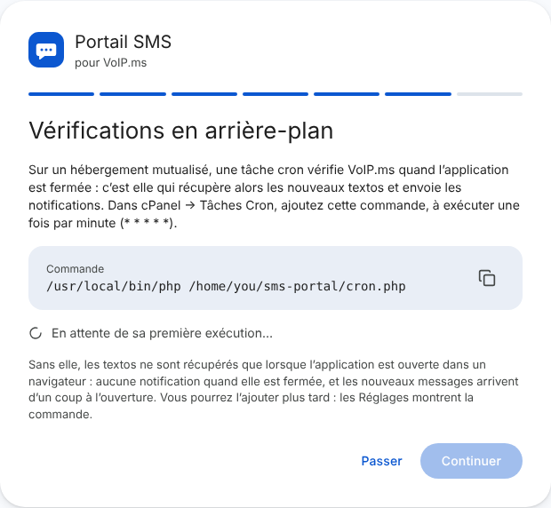

**Mises à jour.** *Réglages* → *Mises à jour* indique quand une nouvelle version sort, avec ce qui change, et l'installe en un clic : le serveur télécharge le zip de la version, le vérifie avec l'empreinte SHA-256 qu'elle annonce et remplace ses propres fichiers, en gardant ceux qu'il remplace dans `sms-portal/data/update/backup/`. `config.php` et `sms-portal/data/` ne sont jamais touchés. Chez les hébergeurs où PHP ne peut pas modifier ses propres fichiers, les *Réglages* indiquent lesquels ; décompressez alors le nouveau zip par-dessus les anciens dossiers. Une version qui demande un PHP plus récent que celui du site attend que vous le choisissiez dans cPanel (*MultiPHP Manager*) : les *Réglages* indiquent lequel.

**Par rapport à Docker :**

- Quand l'application est fermée, c'est la tâche cron qui vérifie VoIP.ms : les nouveaux textos et les notifications peuvent arriver jusqu'à une minute plus tard, davantage chez les hébergeurs qui limitent les tâches cron à toutes les 5 ou 15 minutes (Docker la lance toutes les 10 secondes). Avec le [webhook](#réception-des-textos), ils arrivent tout de suite.
- L'adresse IP à autoriser dans VoIP.ms est celle du serveur, partagée avec les autres sites qu'il héberge : c'est le mot de passe d'API qui protège tout. Si l'hébergeur déplace votre compte sur un autre serveur, la synchronisation s'arrête jusqu'à ce que la nouvelle adresse soit autorisée ; *Réglages* → *Tester la connexion* l'affiche.
- En venant de Docker, ou pour y aller : copiez `data/portal.db` et `data/media/` dans le dossier de données de l'autre (`sms-portal/data/` ici, `./data` avec Docker), avec le même `APP_PASSWORD`. Tout suit, connexions comprises.

## Configuration

| Variable | Défaut | Description |
| --- | --- | --- |
| `APP_PASSWORD` | *(obligatoire)* | Mot de passe protégeant l'interface; en mode Équipe, celui du propriétaire. Le changer déconnecte tout le monde. |
| `VOIPMS_API_USERNAME` / `VOIPMS_API_PASSWORD` | | Courriel du compte VoIP.ms et mot de passe API. Facultatif : sinon, ils sont saisis dans l'assistant et chiffrés avec une clé dérivée d'`APP_PASSWORD`. |
| `POLL_INTERVAL_ACTIVE` | `10` | Secondes entre deux vérifications quand un onglet est ouvert. |
| `POLL_INTERVAL_IDLE` | `60` | Secondes entre deux vérifications sinon. |
| `PUBLIC_URL` | | Adresse de l'application, comme `https://sms.example.com`. Recommandé derrière un proxy inverse : s'il ne transmet pas le `Host` et le protocole d'origine, la connexion serait refusée sans ce réglage. C'est aussi l'adresse qu'appelle VoIP.ms quand les textos sont annoncés par webhook. |
| `TRUST_PROXY` | `false` | `true` derrière un proxy inverse qui gère le HTTPS (cookies sécurisés, vraie IP des clients). `true` ne fait confiance qu'aux proxys sur la boucle locale et les réseaux privés ; on peut aussi lister des adresses/sous-réseaux (`10.0.0.5, 172.16.0.0/12`). |
| `DATA_DIR` | `./data` (`/data` dans Docker, `sms-portal/data` en hébergement mutualisé) | Emplacement de la base et des médias. |
| `PORT` | `8080` | Docker : le port qu'écoute le serveur dans le conteneur. |
| `SESSION_DAYS` | `30` | Durée d'une connexion. |
| `VOIPMS_TIMEZONE` | `America/New_York` | Fuseau des dates renvoyées par VoIP.ms. À laisser tel quel. |
| `VAPID_SUBJECT` | URL du projet | Contact (`mailto:vous@example.com` ou une URL `https://`) transmis aux services push des navigateurs avec chaque notification. |
| `ALLOWED_DIDS` | | Les seuls numéros du compte qu'utilise le portail, séparés par des virgules (`514 555-0100, 450-555-0199`). Les autres n'apparaissent nulle part et leurs textos ne sont pas récupérés : pour les comptes dont certains numéros appartiennent à quelqu'un d'autre. Sur un hébergement mutualisé, `config.php` accepte aussi une liste (`['5145550100', '4505550199']`). |
| `EXCLUDED_DIDS` | | Numéros du compte que le portail laisse de côté, sous la même forme ; ils l'emportent sur `ALLOWED_DIDS`. Les textos déjà enregistrés d'un numéro écarté restent dans la base, cachés : ils reviennent s'il est permis de nouveau. |
| `DEMO_MODE` | `false` | Données fictives au lieu d'un vrai compte. |
| `UPDATE_CHECK` | `true` | Vérifier s'il y a de nouvelles versions (*Réglages* → *Mises à jour* lit le `release.json` de la plus récente sur GitHub, au plus toutes les 6 heures). `UPDATE_MANIFEST_URL` fait pointer une copie dérivée (fork) vers ses propres versions. |
| `PUID` / `PGID` | `1000` | Docker seulement : utilisateur/groupe propriétaire de `./data` qui exécute l'application (le conteneur démarre en root uniquement pour corriger le propriétaire du dossier et lancer Apache, dont les processus et les vérifications de VoIP.ms tournent ensuite sous cet utilisateur). |

## Préparer votre compte VoIP.ms

1. **Accès API** : dans le portail VoIP.ms, *Main Menu → SOAP & REST/JSON API* : définissez un **mot de passe API** (différent de votre mot de passe de connexion) et cliquez sur *Enable/Disable API*.
2. **IP autorisée** : VoIP.ms ne répond qu'aux adresses autorisées. L'assistant affiche l'adresse que VoIP.ms voit pour votre serveur ; ajoutez-la dans *Enable IP Addresses*. Pour une connexion résidentielle dont l'IP change, VoIP.ms accepte aussi les plages (`203.0.113.0/24`), les jokers (`203.0.113.*`) et les noms de domaine (DNS dynamique).
3. **SMS sur vos numéros** : activer dans l'assistant (ou les *Réglages*) un numéro sans SMS les active dans VoIP.ms, en gardant ses réglages de courriel et de renvoi ; à la main, c'est sous *DID Numbers → Manage DID(s)*, modifiez le numéro, *Message Service (SMS/MMS)*. Par défaut, VoIP.ms limite l'envoi par l'API à 100 SMS par jour ([messaging@voip.ms](mailto:messaging@voip.ms) peut l'augmenter).

## Sécurité

- Le mot de passe API de VoIP.ms **donne accès à tout le compte** (commander ou annuler des numéros, routage des appels, messagerie vocale…) et ne peut pas être restreint. Gardez cette instance privée et protégée par un `APP_PASSWORD` solide.
- Mettez-la derrière HTTPS si vous l'ouvrez sur Internet (voir plus bas) et définissez `TRUST_PROXY=true`. Assurez-vous alors que le port de l'application n'est joignable que par le proxy (par exemple `127.0.0.1:8080:8080` dans `docker-compose.yml`).
- Les tentatives de connexion sont limitées, les sessions sont des cookies signés `HttpOnly`/`SameSite=Lax` et les écritures provenant d'un autre site sont refusées. Les sessions sont gardées dans la base de données, qui ne conserve qu'un hachage de leurs identifiants : se déconnecter, ou déconnecter un autre appareil depuis *Réglages* → *Mon compte*, en termine une pour de bon. En mode Équipe, les mots de passe sont gardés sous forme de hachages PBKDF2-SHA256 (600 000 itérations). Les fichiers reçus sont servis avec une CSP de type « sandbox ». La CSP de l'application n'exécute que ses propres scripts, plus le WebAssembly (`'wasm-unsafe-eval'`) qui décode les messages vocaux AMR.

### Derrière un proxy inverse

Transmettez l'hôte et le protocole d'origine (ou réglez `PUBLIC_URL`), et réglez `TRUST_PROXY=true`, pour que la limite de tentatives de connexion compte chaque client plutôt que le proxy. Voir les exemples Caddy et nginx dans le [README anglais](README.md#behind-a-reverse-proxy).

## Mettre en place les notifications push

- **HTTPS obligatoire** pour les navigateurs (`http://localhost` fonctionne pour les essais). Placez l'application derrière un proxy inverse (voir plus haut).
- **À activer sur chaque appareil** dans *Réglages → Notifications*. *Envoyer une notification test* vérifie toute la chaîne.
- **iPhone et iPad** (iOS 16.4 ou plus récent) : ouvrez le site dans Safari, *Partager → Sur l'écran d'accueil*, puis activez les notifications depuis l'application installée. Safari n'offre pas le push aux onglets ordinaires.
- **Délai.** VoIP.ms est interrogé périodiquement : sans onglet ouvert, une notification arrive au plus `POLL_INTERVAL_IDLE` secondes (60 par défaut) après le texto. Réduisez-le (par exemple à `20`) pour être averti plus vite.
- **Confidentialité.** Les notifications affichent l'expéditeur et le début du texto. Elles sont chiffrées pour le navigateur qui les reçoit : Google, Mozilla, Apple ou Microsoft, qui les relaient, voient seulement qu'une notification a été envoyée. Se déconnecter d'un appareil arrête ses notifications ; changer `APP_PASSWORD` les arrête partout.
- Les clés VAPID du serveur sont créées au premier démarrage et conservées dans la base (`./data`) ; aucun compte chez un fournisseur de push n'est nécessaire.

## Fonctionnement

- **Synchronisation.** `getSMS` et `getMMS` sont appelés séparément (avec `all_messages=1`, VoIP.ms mélange les deux sans les distinguer, et leurs identifiants se chevauchent). Chaque message est enregistré une seule fois ; ceux envoyés d'ailleurs (votre cellulaire, le portail VoIP.ms) apparaissent aussi. La toute première synchronisation et les imports d'historique ne marquent rien comme non lu. Avec le webhook, un appel de VoIP.ms (`/api/voipms/callback/<secret>`) ne fait que lancer une vérification ; son contenu n'est jamais enregistré, puisque rien ne prouve qu'il vient de VoIP.ms.
- **Médias.** Les liens des médias VoIP.ms sont publics et peuvent répondre 404 un moment après l'envoi : les téléchargements sont réessayés avec un délai croissant pendant environ 6 heures (et à la demande depuis la conversation).
- **Dates.** VoIP.ms renvoie l'heure de l'Est ; son paramètre `timezone` ignore l'heure avancée, donc les dates sont converties avec le fuseau IANA.
- **Push.** Chaque navigateur a un identifiant aléatoire, partagé par ses onglets et son abonnement push ; les onglets ouverts signalent s'ils sont visibles et le serveur évite les navigateurs qui affichent l'application. Les messages sont chiffrés selon la RFC 8291 et signés avec VAPID (RFC 8292) par l'extension openssl de PHP, sans bibliothèque tierce.
- **Envoi.** Le message est enregistré immédiatement puis livré en arrière-plan ; si VoIP.ms échoue de façon ambiguë (délai, erreur Cloudflare 5xx) alors que le message est bien parti, il est rapproché de l'historique au lieu d'apparaître en double. Un message en échec peut être renvoyé.
- **Technologies.** Le serveur est en PHP 8.4+, sans paquet Composer, avec SQLite ; le client, en React + Vite et TypeScript. Un seul serveur pour les deux façons de l'héberger : Docker le fait tourner sous Apache avec le même `.htaccess` que l'hébergement mutualisé, plus sa tâche cron toutes les 10 secondes, dans un seul conteneur, sans service externe.
- **Pas de processus à lui.** Chaque requête est un processus PHP : le serveur garde donc dans la base les mises à jour que les onglets ouverts viennent chercher (toutes les 3 s), les onglets ouverts et l'état de la synchronisation ; des verrous de fichier évitent qu'une vérification et un envoi se chevauchent. `tests/` vérifie l'API en mode démo, le client VoIP.ms contre un faux VoIP.ms en HTTP, et les classes du serveur en PHP.

## Développement

Il faut Node.js 22+ pour le client et les outils, et PHP 8.4+ (avec `pdo_sqlite`, `openssl`, `curl`, `mbstring` et `intl`) pour le serveur et les tests.

```bash
npm install
DEMO_MODE=true APP_PASSWORD=dev npm run dev   # API sur :8080 (serveur intégré de PHP), interface sur http://localhost:5173
npm test
npm run typecheck
npm run build:cpanel                          # dist/sms-portal-cpanel-<version>.zip
docker build -t sms-portal .                  # l'image Docker
```

**Captures d'écran.** `npm run screenshots` refait celles de ce README (`docs/screenshots/en` et `fr`) à partir du mode démo, à une date fixe, et liste celles dont l'apparence a changé : lancez-la après avoir modifié l'interface, puis faites un commit de ce qui a bougé. Il faut un Chromium pour Playwright, une fois : `npx playwright-core install chromium`. Les polices varient d'un système à l'autre : comparez des exécutions faites sur la même machine.

### Versions

La version est dans `package.json` ([gestion sémantique de version](https://semver.org/lang/fr/)) et s'affiche dans les *Réglages* ; les changements vont sous *Unreleased* dans [CHANGELOG.md](CHANGELOG.md) au fur et à mesure. Pour publier une version :

1. `npm run release:prepare -- minor` (ou `major`, `patch`, `X.Y.Z`) : augmente la version dans `package.json` et transforme *Unreleased* en section de la nouvelle version, datée du jour.
2. Faites un commit, ouvrez une demande de fusion (pull request) et fusionnez-la.

Sur `main`, le workflow *Release* voit une version sans étiquette et la publie : il lance les tests, étiquette `vX.Y.Z`, crée la version sur GitHub avec la section du journal comme notes, y joint le zip cPanel et `release.json` (ce que les serveurs en marche lisent pour proposer la mise à jour), et pousse l'image Docker sur `ghcr.io` (`X.Y.Z`, `X.Y` et `latest`). La première fois, rendez l'image publique : sur GitHub, *Packages* → *voip-ms-sms-portal* → *Package settings* → *Change visibility*. Après une mise à jour, les onglets déjà ouverts proposent de recharger la page.

## Licence

[Apache 2.0](LICENSE). Projet non affilié à VoIP.ms.
