# SMS Portal for VoIP.ms

A clean, modern, self-hosted web interface for the texts (SMS/MMS) of your [VoIP.ms](https://voip.ms) numbers, in the spirit of Google Messages for web.

*[Version française](README.fr.md)*

**New to self-hosting?** The [step-by-step installation guide](docs/install.md) starts from zero: what you need, then every click, on cPanel web hosting or with Docker.

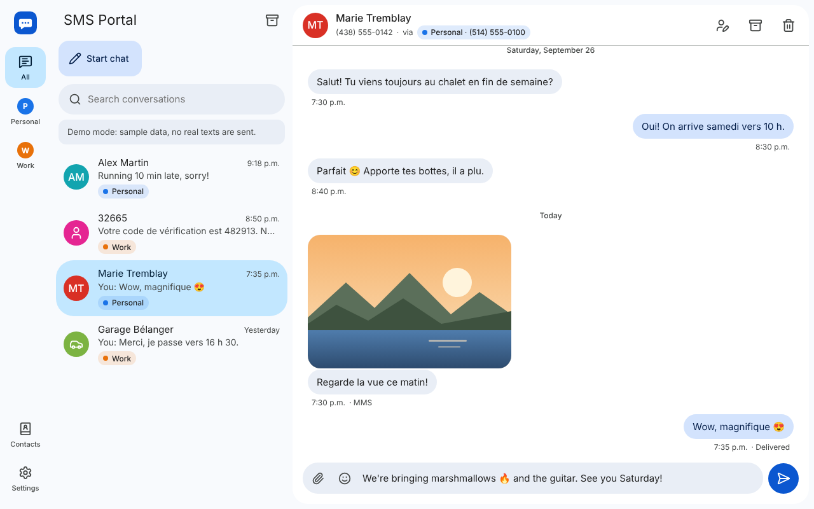

- **All your numbers in one place.** A side rail (filter chips on mobile) switches between "all numbers" and each DID. Give every number a name and a color to recognize it at a glance; each conversation shows which of your numbers it belongs to and replies always leave from that number.
- **Incoming texts, checked or announced.** The server polls VoIP.ms (every 10 s while the app is open in a browser, every 60 s otherwise), which needs nothing exposed to the Internet; or, when the portal is reachable over HTTPS, VoIP.ms calls it as soon as a text comes in. Messages received while the server was down are fetched when it comes back.
- **SMS or MMS, automatically.** VoIP.ms counts its 160-character SMS limit in *bytes* (an accented letter counts for 2, an emoji for 4). The message box shows the count and switches to MMS when needed, or when you attach a file.
- **Attachments.** Send pictures, videos, audio clips and vCards (up to 3 per message); large photos are resized in the browser to fit VoIP.ms's 1.2 MB limit. Received media is downloaded and kept locally. Voice messages, including the AMR files phones send them in, play in a player that shows their waveform.
- **Setup wizard.** It walks you through enabling the API, shows the exact IP address to whitelist, tests the connection, lists your numbers and imports your history.
- **Push notifications**, even when the app is closed or the phone locked, on every device where you turn them on.
- **Archive** the conversations you are done with; they come back as soon as a new text arrives. **Delete** messages or whole conversations, in the portal only or at VoIP.ms too.
- **Contacts** with vCard import (Google Contacts, iCloud, Android…), an emoji picker, search that ignores accents ("belanger" finds "Bélanger"), light/dark themes, French and English, installable as an app on phones.
- **Docker or shared hosting.** One container, or ordinary PHP web hosting (cPanel) with a cron job: no Node.js needed there. See [Shared hosting](#shared-hosting-cpanel).

## A quick tour

*All screenshots come from the demo mode (`DEMO_MODE=true`): the numbers, names and messages are made up.*

### One inbox, several numbers

The rail on the left lists your VoIP.ms numbers. "All" mixes every conversation, with a colored chip telling which number each one belongs to; picking a number shows only its conversations. Contacts and Settings sit at the bottom.

| All numbers | Only the "Work" number |
| --- | --- |
| 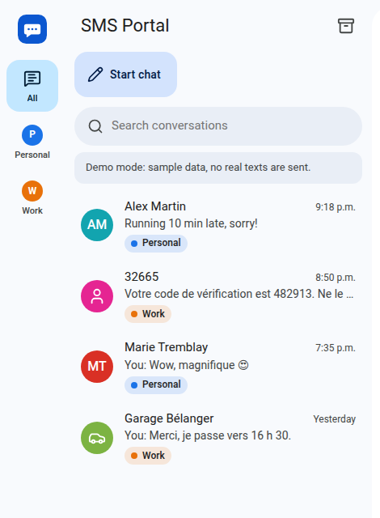 | 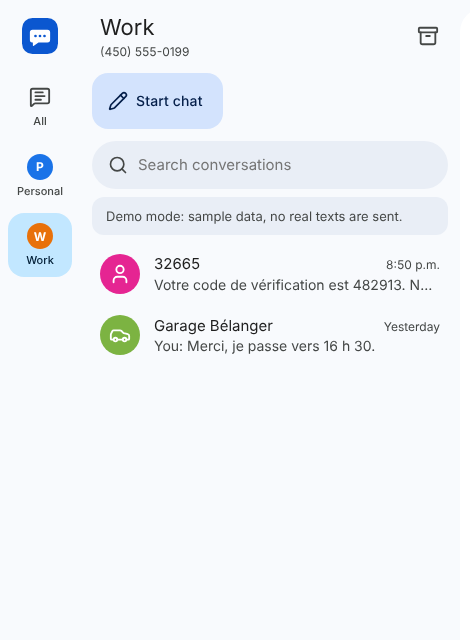 |

### SMS or MMS: the message box decides

As long as the text fits in 160 bytes, it leaves as an SMS and the counter shows how much room is left:


A longer text, or a file, turns it into an MMS (up to 2048 bytes). The chip says so before you hit send; there is no splitting into several SMS.


### Emoji

The smiley button opens a picker above the message box, with your recent emoji first. It stays open so you can add several in a row, and inserts them where the cursor is.

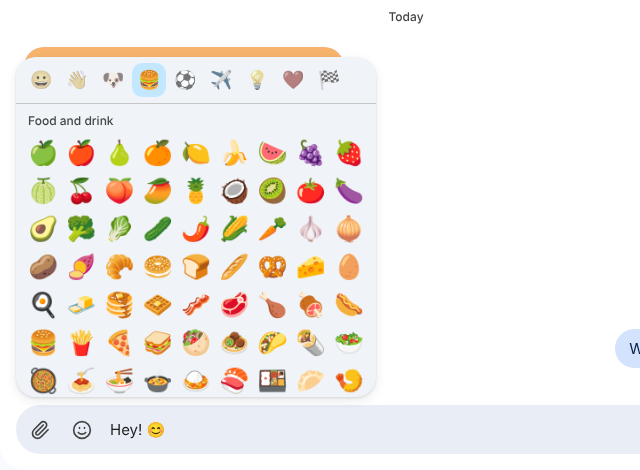

### Starting a conversation

Type a name or a number: contacts are suggested as you type. With several numbers, choose which one the text leaves from. If a conversation already exists with that person on that number, you land in it.

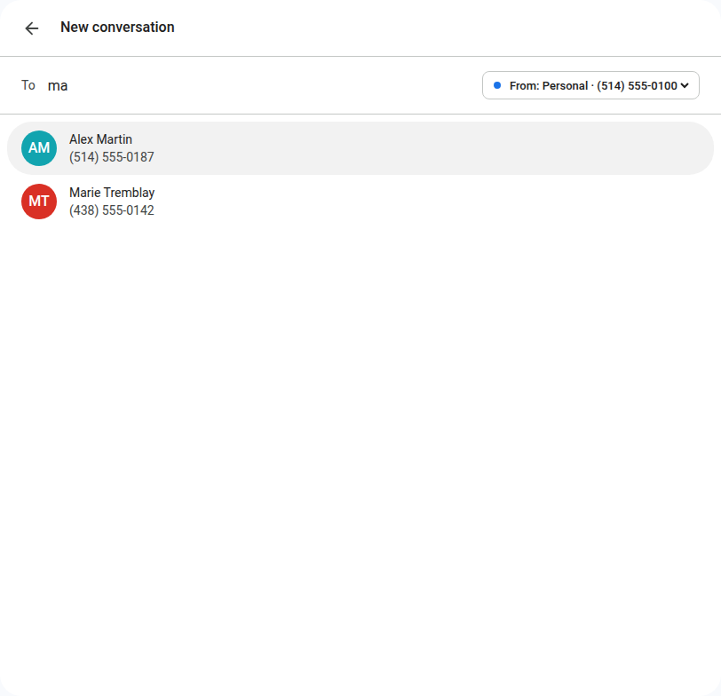

### Setup wizard

On first launch, the wizard checks the credentials, shows the IP address VoIP.ms sees (to add to its whitelist), then lists your numbers so you can pick, name and color them. Turning on a number whose SMS is off enables it in your VoIP.ms account; the row says so beforehand. It then asks how new texts should reach the portal (see [Receiving texts](#receiving-texts)).

| Allowing the IP address | Choosing your numbers |
| --- | --- |
| 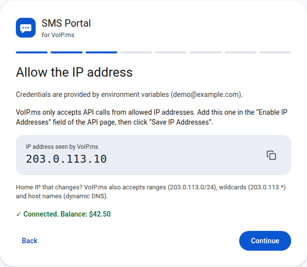 | 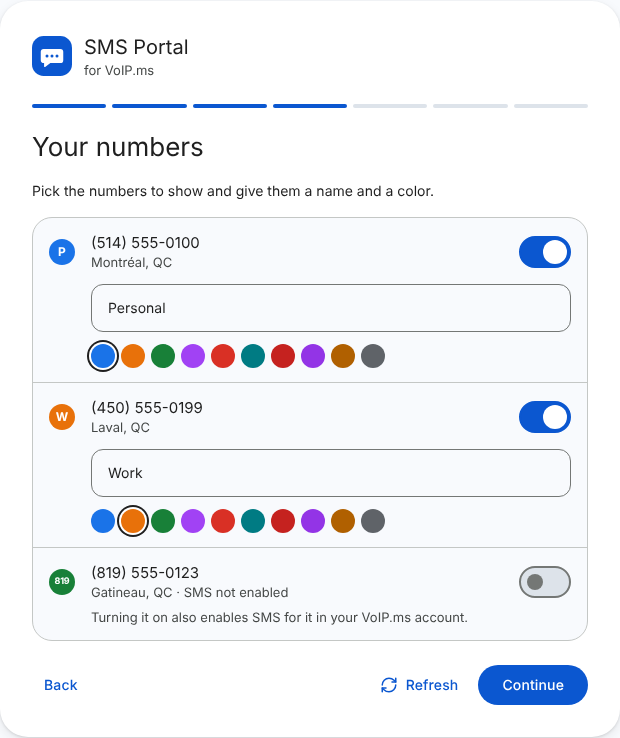 |

### Contacts

Contacts are stored on the server, so every browser sees the same names. Add them by hand or import a `.vcf` file exported from Google Contacts, iCloud or your phone. Each one can have its own avatar color, and an icon instead of its initials (home, work, family, car…); numbers are formatted as you type them.

To delete many at once, tap *Select*, tick contacts or *Select all* (after a search, all the contacts it found), then *Delete*; their conversations stay. Right after an import, *Undo* removes the contacts it added, if the wrong file went in.

| Contact list | Editing a contact |
| --- | --- |
| 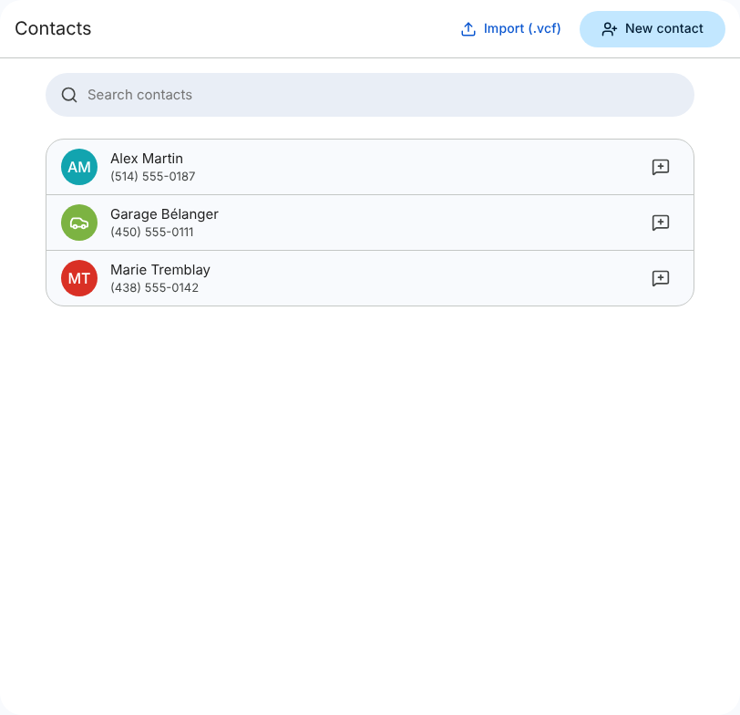 | 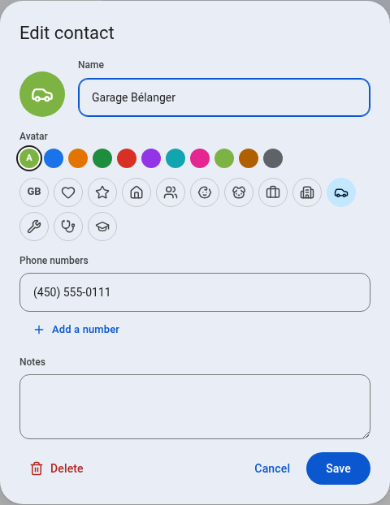 |

### Archive

The archive button in a conversation's header puts it away (with an *Undo*); the box icon above the list opens the archive. A new text, received or sent, brings the conversation back to the main list. Searching the main list also looks through archived conversations and flags them.

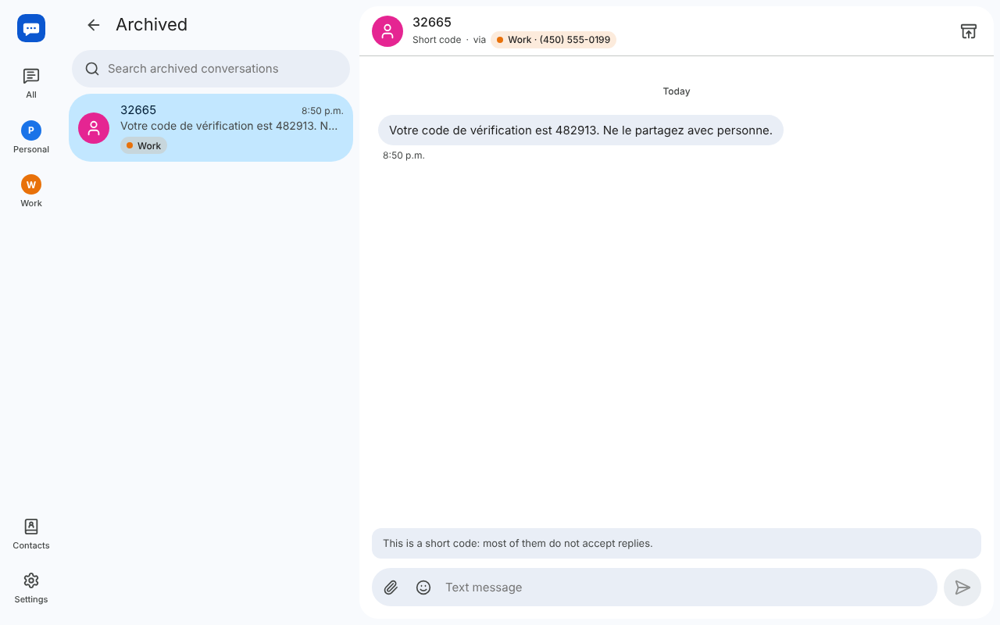

### Deleting

Tap a message to show its *Delete* button; the bin in a conversation's header deletes the whole conversation. Deleted texts leave the portal for good, on every device: checking VoIP.ms does not bring them back. VoIP.ms keeps its own copy in your account's history unless you tick *Delete at VoIP.ms too*, which erases it there as well, for good (the portal does it in the background, one message at a time). A new text brings a deleted conversation back, with that text only.

### Push notifications

Turn them on in Settings, on each device: phone, computer, tablet. They arrive even when no tab is open, and skip the device where the app is already on screen. Once the app is installed, its icon also shows the number of unread texts (iPhone, iPad, Windows, macOS; Android shows a dot). See [Setting up push notifications](#setting-up-push-notifications) for what they need.

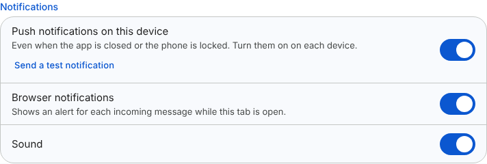

### Receiving texts

By default the portal checks VoIP.ms on a schedule, which works anywhere, even on a home network with nothing open to the Internet. When the portal is reachable over HTTPS (shared hosting always is; with Docker, set `PUBLIC_URL`), choose *Instantly, through a VoIP.ms webhook* in the wizard or in *Settings* → *Receiving texts*: the portal sets each number's "SMS/MMS URL Callback" at VoIP.ms itself, and VoIP.ms then calls the portal as soon as one of your numbers receives a text.

- A number that already sends its texts to another address (a CRM, another app) keeps it unless you choose *Replace*; going back to regular checks gives it back.
- A call from VoIP.ms only makes the portal check VoIP.ms right away, so a call that does not come from VoIP.ms cannot bring in a fake text. Its address holds a secret all the same.
- A check still runs every 15 minutes: VoIP.ms only calls for texts your numbers receive, not for those sent from other apps, and a call can be missed while the server is down.

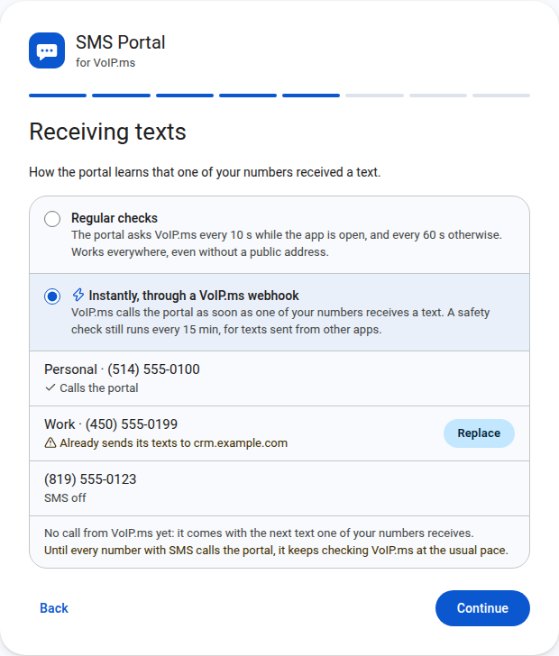

### Settings

Rename or recolor numbers, turn off the ones you do not use, sync now or import older history, test the VoIP.ms connection, and choose notifications, theme and language.

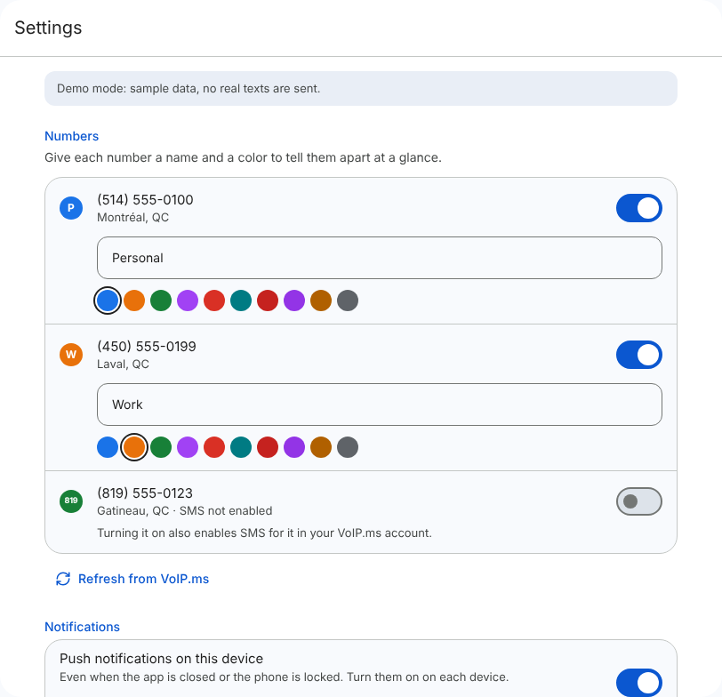

### Team mode

For an office or a family, where several people answer the texts. The owner turns it on in *Settings* → *Team mode* by creating the first administrator, for good. Each person then signs in with their own email and password. Administrators add the users and choose the numbers each one texts from, read only or with sending; they give a new password to whoever forgot theirs, and suspend or delete an account. Users see only their own settings. Everyone can see the browsers signed in to their account and sign any of them out, in *Settings* → *My account*. `APP_PASSWORD` still opens the portal as its owner (*Owner sign-in*), for when no administrator can.

### On a phone, and in the dark

The layout adapts to small screens (numbers become filter chips). On a phone, a banner offers to install the app on the home screen, then to turn on notifications. The dark theme follows the system or can be forced.

| Conversations | A conversation |
| --- | --- |
| 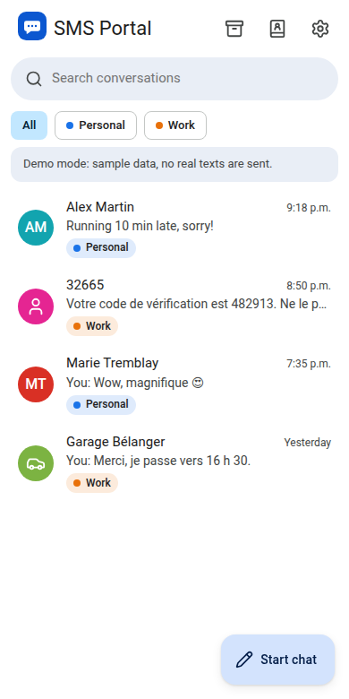 |  |

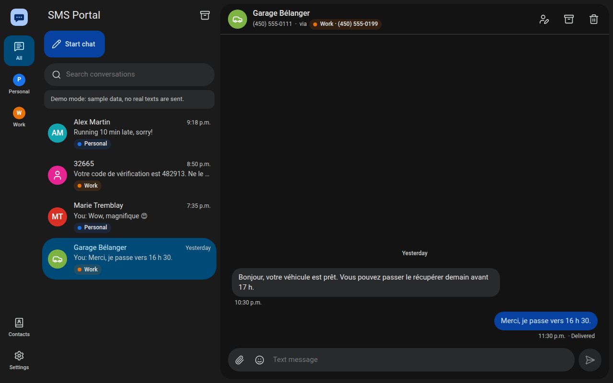

## Quick start (Docker)

Never used Docker? The [step-by-step guide](docs/install.md#2b-install-with-docker) takes it from the start.

```bash
git clone https://github.com/dansleboby/voip-ms-sms-portal.git
cd voip-ms-sms-portal
cp .env.example .env        # then set APP_PASSWORD
docker compose up -d
```

Open <http://localhost:8080>, sign in with `APP_PASSWORD` and follow the wizard. Data (SQLite database and media) lives in `./data`; the container makes it writable for the app user on startup (see `PUID`/`PGID`).

Compose runs the image published with each [release](https://github.com/dansleboby/voip-ms-sms-portal/releases) (`ghcr.io/dansleboby/voip-ms-sms-portal`, for x86 and ARM), and builds it from the folder when it cannot pull it; `docker compose up -d --build` always builds from source.

**Updating.** *Settings* → *Updates* says when a new version is out, with what changed. Then, where `docker-compose.yml` is: `docker compose pull && docker compose up -d`. Your data stays in `./data`. (A container cannot replace its own image, so this one does not update itself.)

Want to look around first? Start it with `DEMO_MODE=true`: sample numbers and conversations, an auto-reply, and no real texts sent.

## Shared hosting (cPanel)

The same app also runs on ordinary PHP web hosting, without Docker or Node.js: a PHP version of the server answers the same API, and a cron job checks VoIP.ms while the app is closed.

**You need** PHP 8.1 or later with `pdo_sqlite`, `openssl`, `curl` and `mbstring` (all on by default in cPanel), a subdomain with HTTPS, and cron jobs. The steps below are the short version; the [step-by-step guide](docs/install.md#2a-install-on-cpanel-web-hosting) gives every click.

1. Get `sms-portal-cpanel-<version>.zip`, attached to each [release](https://github.com/dansleboby/voip-ms-sms-portal/releases) (or build it: `npm run build:cpanel`), and extract it in your home folder (cPanel → *File Manager* → *Upload*, then *Extract*). You get two folders side by side: `sms-portal/`, the server with its settings and data, never served, and `sms-portal-site/`, what the browser loads.
2. Create the subdomain (cPanel → *Domains* → *Create A New Domain*) with `sms-portal-site` as its document root, and make sure it has HTTPS (cPanel → *SSL/TLS Status* → *Run AutoSSL*). Keep the two folders side by side: if every page answers *Forbidden*, the document root is `sms-portal` or a folder inside it, or the web server cannot read the site's files (they need permissions 644, and folders 755).
3. In `sms-portal/`, copy `config.sample.php` to `config.php` and set `APP_PASSWORD`. The other settings are those of the [table below](#configuration), apart from the Docker ones (`PORT`, `TRUST_PROXY`, `LIVE_UPDATES`, `PUID`/`PGID`).
4. Open the subdomain, sign in and follow the wizard. Its last step gives the cron job to add (cPanel → *Cron Jobs*), once per minute, such as `/usr/local/bin/php /home/you/sms-portal/cron.php`, and sees it start; you can skip it, at the cost of texts and notifications only coming in while the app is open. *Settings* shows the line too, and whether the job runs.

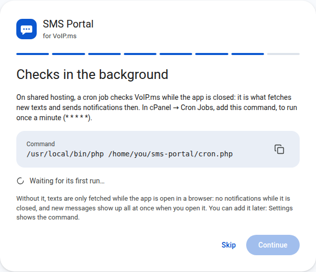

**Updating.** *Settings* → *Updates* says when a new version is out, with what changed, and installs it in one click: the server downloads the release's zip, checks it against the SHA-256 the release announces, and replaces its own files, keeping the ones it replaces in `sms-portal/data/update/backup/`. `config.php` and `sms-portal/data/` are never touched. On hosts where PHP cannot write to its own files, *Settings* says which ones; extract the new zip over the old folders instead.

**Compared with Docker:**

- Open tabs ask for updates every 3 s instead of keeping a connection open: a reply or a send's outcome can take a few seconds to show.
- While the app is closed, the cron job checks VoIP.ms: new texts and push notifications can come up to a minute late, more on hosts that only allow cron jobs every 5 or 15 minutes. With the [webhook](#receiving-texts) on, they come right away.
- The IP address to allow in VoIP.ms is the server's, shared with the other sites it hosts: the API password does all the protecting. If the host moves your account to another server, sync stops until the new address is allowed; *Settings* → *Test connection* shows it.
- Moving from Docker: copy `data/portal.db` and `data/media/` into `sms-portal/data/`. Everything carries over except the VoIP.ms API password, which the wizard asks for again (the two versions derive their encryption key differently), and push notifications, to turn on again on each device.

## Configuration

| Variable | Default | Description |
| --- | --- | --- |
| `APP_PASSWORD` | *(required)* | Password protecting the interface; in Team mode, the owner's. Changing it signs everyone out. |
| `VOIPMS_API_USERNAME` / `VOIPMS_API_PASSWORD` | | VoIP.ms account email and API password. Optional: otherwise they are entered in the wizard and stored encrypted with a key derived from `APP_PASSWORD`. |
| `POLL_INTERVAL_ACTIVE` | `10` | Seconds between checks while a browser tab is open. |
| `POLL_INTERVAL_IDLE` | `60` | Seconds between checks when nobody is looking. |
| `PUBLIC_URL` | | Address of the app, like `https://sms.example.com`. Recommended behind a reverse proxy: one that does not pass the original `Host` and protocol along would otherwise get sign-ins refused. Also the address VoIP.ms calls when texts are announced by webhook. |
| `LIVE_UPDATES` | `stream` | How open tabs receive new texts and changes. `stream` keeps one connection open per tab (Server-Sent Events); `poll` has each tab ask every 3 s instead, for proxies or hosts that cannot pass a stream through. |
| `TRUST_PROXY` | `false` | Set to `true` behind a reverse proxy terminating HTTPS (secure cookies, real client IP). `true` trusts proxies on loopback and private networks only; you can also list addresses/subnets (`10.0.0.5, 172.16.0.0/12`). |
| `DATA_DIR` | `./data` (`/data` in Docker, `sms-portal/data` on shared hosting) | Database and media location. |
| `PORT` | `8080` | HTTP port. |
| `SESSION_DAYS` | `30` | How long a sign-in lasts. |
| `VOIPMS_TIMEZONE` | `America/New_York` | Time zone of the dates VoIP.ms returns. Leave as is. |
| `VAPID_SUBJECT` | project URL | Contact (`mailto:you@example.com` or an `https://` URL) sent to browser push services with each notification. |
| `ALLOWED_DIDS` | | The only numbers of the account the portal uses, separated by commas (`514 555-0100, 450-555-0199`). The others do not show up anywhere and their texts are not fetched: for accounts with numbers that belong to someone else. On shared hosting, `config.php` also takes a list (`['5145550100', '4505550199']`). |
| `EXCLUDED_DIDS` | | Numbers of the account the portal leaves alone, in the same form; they win over `ALLOWED_DIDS`. Texts already stored from a number left out stay in the database, hidden: they come back if it is allowed again. |
| `DEMO_MODE` | `false` | Sample data instead of a real account. |
| `UPDATE_CHECK` | `true` | Look for new releases (*Settings* → *Updates* reads the newest one's `release.json` on GitHub, at most every 6 hours). `UPDATE_MANIFEST_URL` points a fork at its own releases. |
| `PUID` / `PGID` | `1000` | Docker only: user/group that owns `./data` and runs the app (the container starts as root just to fix the folder's owner, then drops privileges). |

## Preparing your VoIP.ms account

1. **API access**: in the VoIP.ms portal, *Main Menu → SOAP & REST/JSON API*: set an **API password** (different from your login password) and click *Enable/Disable API*.
2. **Allowed IP**: VoIP.ms only answers API calls from whitelisted addresses. The wizard shows the address VoIP.ms sees for your server; add it under *Enable IP Addresses*. For a home connection whose IP changes, VoIP.ms also accepts ranges (`203.0.113.0/24`), wildcards (`203.0.113.*`) and host names (dynamic DNS).
3. **SMS on your numbers**: turning on a number without SMS in the wizard (or in *Settings*) enables it in VoIP.ms, keeping its email and forwarding settings; by hand, it is under *DID Numbers → Manage DID(s)*, edit the number, *Message Service (SMS/MMS)*. By default VoIP.ms limits sending through the API to 100 SMS per day ([messaging@voip.ms](mailto:messaging@voip.ms) can raise it).

## Security

- The VoIP.ms API password **gives access to the whole account** (ordering and cancelling numbers, call routing, voicemail…) and cannot be restricted. Keep this instance private and protected by a strong `APP_PASSWORD`.
- Put it behind HTTPS if you open it to the Internet (see below) and set `TRUST_PROXY=true`. Then make sure the app's port is only reachable through the proxy (for example `127.0.0.1:8080:8080` in `docker-compose.yml`).
- Sign-in attempts are rate limited, sessions are signed `HttpOnly`/`SameSite=Lax` cookies and cross-site writes are refused. Sessions are kept in the database, which stores only a hash of their ids: signing out, or out of another device from *Settings* → *My account*, ends one for good. In Team mode, passwords are stored as PBKDF2-SHA256 hashes (600,000 rounds). Received files are served with a sandboxing CSP. The app's own CSP runs only its own scripts, plus WebAssembly (`'wasm-unsafe-eval'`), which decodes AMR voice messages.

### Behind a reverse proxy

Live updates use Server-Sent Events (`/api/events`): disable response buffering for that path. If your proxy cannot do that, set `LIVE_UPDATES=poll`.

**Caddy**

```caddy
sms.example.com {
    reverse_proxy localhost:8080 {
        flush_interval -1
    }
}
```

**nginx**

```nginx
location / {
    proxy_pass http://127.0.0.1:8080;
    proxy_set_header Host $host;
    proxy_set_header X-Forwarded-For $proxy_add_x_forwarded_for;
    proxy_set_header X-Forwarded-Proto $scheme;
    proxy_buffering off;   # Server-Sent Events
    client_max_body_size 5m;
}
```

## Setting up push notifications

- **HTTPS is required** by browsers (plain `http://localhost` works for testing). Put the app behind a reverse proxy as shown above.
- **Turn them on on each device** in *Settings → Notifications*. *Send a test notification* checks the whole chain.
- **iPhone and iPad** (iOS 16.4 or later): open the site in Safari, *Share → Add to Home Screen*, then turn notifications on from the installed app. Safari does not offer push to regular tabs.
- **Delay.** VoIP.ms is polled, so a notification arrives at most `POLL_INTERVAL_IDLE` seconds (60 by default) after the text when no tab is open. Lower it (for example to `20`) for quicker alerts.
- **Privacy.** Notifications show the sender and the beginning of the text. They are encrypted for the receiving browser: Google, Mozilla, Apple or Microsoft, which relay them, only see that a notification was sent. Signing out of a device stops its notifications; changing `APP_PASSWORD` stops them everywhere.
- The server's VAPID keys are generated on first start and kept in the database (`./data`); no account with a push provider is needed.

## How it works

- **Sync.** `getSMS` and `getMMS` are called separately (with `all_messages=1` VoIP.ms mixes both kinds without saying which is which, and their ids overlap). Each message is stored once, keyed by kind and VoIP.ms id; messages sent from elsewhere (your phone, the VoIP.ms portal) show up too. The very first sync and history imports do not mark anything unread. With the webhook on, a call from VoIP.ms (`/api/voipms/callback/<secret>`) only starts a check; what it says is never stored, since nothing proves it comes from VoIP.ms.
- **Media.** VoIP.ms media links are public and can answer 404 for a while after a message is sent, so downloads are retried with backoff for about 6 hours (and on demand from the conversation).
- **Dates.** VoIP.ms returns US Eastern wall-clock times; its `timezone` parameter ignores daylight saving time, so dates are converted with the IANA zone instead.
- **Push.** Each browser has a random id, shared by its tabs and its push subscription; open tabs report whether they are visible, and the server skips the browsers showing the app. Payloads are encrypted per RFC 8291 and signed with VAPID (RFC 8292) using Node's crypto, without a third-party library.
- **Sending.** A message is saved immediately and delivered in the background; if VoIP.ms fails ambiguously (timeout, Cloudflare 5xx) and the message still went out, it is matched with the history instead of appearing twice. Failed messages can be retried.
- **Stack.** Node.js 22+, Fastify, SQLite (better-sqlite3), React + Vite, TypeScript everywhere. A single container, no external service.
- **Shared hosting.** `php/` holds the PHP version of the server: PHP 8.1+, no Composer package, the same database schema. With no process of its own, it keeps in the database what the Node server keeps in memory: the live updates tabs poll for, the open tabs, sync state; file locks keep a check and a send from overlapping. `tests/` runs the same API checks against both servers, and the PHP one against a fake VoIP.ms over HTTP.

## Development

```bash
npm install
DEMO_MODE=true APP_PASSWORD=dev npm run dev   # API on :8080, UI on http://localhost:5173
npm test                                      # unit and API tests
npm run typecheck
npm run build && APP_PASSWORD=dev npm start   # production build
```

The PHP version, after `npm run build:web` (needs PHP 8.1+; `npm test` also tests it when `php` is installed):

```bash
SMS_PORTAL_DIR=php/app DEMO_MODE=true APP_PASSWORD=dev php -S 127.0.0.1:8090 -t dist/web php/dev-router.php
npm run build:cpanel                          # dist/sms-portal-cpanel-<version>.zip
```

If your network goes through an HTTP proxy, Node's `fetch` needs `NODE_USE_ENV_PROXY=1` (Node ≥ 22.21) to use `HTTPS_PROXY`.

**Screenshots.** `npm run screenshots` takes the ones in this README again (`docs/screenshots/en` and `fr`) from the demo mode, on a fixed date, and lists those whose look changed: run it after changing the interface, and commit what moved. It needs a Chromium for Playwright, once: `npx playwright-core install chromium`. Fonts differ between systems: compare runs made on the same machine.

### Versions

The version lives in `package.json` ([Semantic Versioning](https://semver.org/)) and is shown in *Settings*; changes go under *Unreleased* in [CHANGELOG.md](CHANGELOG.md) as they are made. To release:

1. `npm run release:prepare -- minor` (or `major`, `patch`, `X.Y.Z`): bumps `package.json` and turns *Unreleased* into the new version's section, dated today.
2. Commit, open a pull request, merge it.

On `main`, the *Release* workflow sees a version without a tag and publishes it: it runs the tests, tags `vX.Y.Z`, creates the GitHub release with the changelog section as notes, attaches the cPanel zip and `release.json` (what running servers read to offer the update), and pushes the Docker image to `ghcr.io` (`X.Y.Z`, `X.Y` and `latest`). The first time, make the image public: on GitHub, *Packages* → *voip-ms-sms-portal* → *Package settings* → *Change visibility*. After an update, tabs that were already open offer to reload.

## Roadmap ideas

- Optional VoIP.ms webhook/URL callback for instant delivery (and instant notifications) when the instance is reachable from the Internet

## License

[Apache 2.0](LICENSE). Not affiliated with VoIP.ms.
