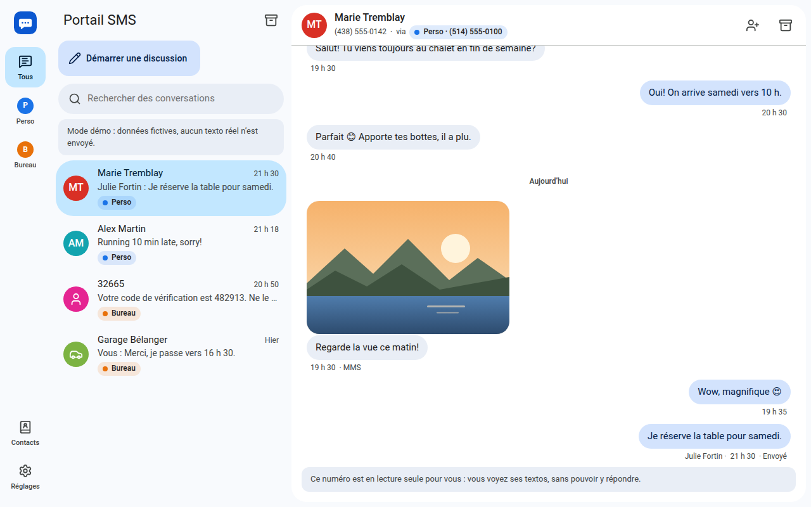
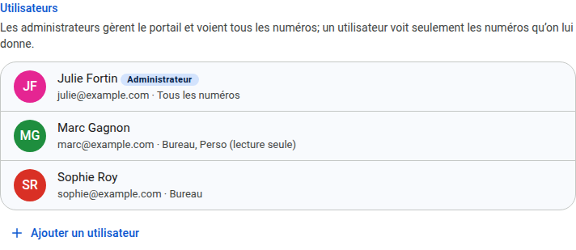
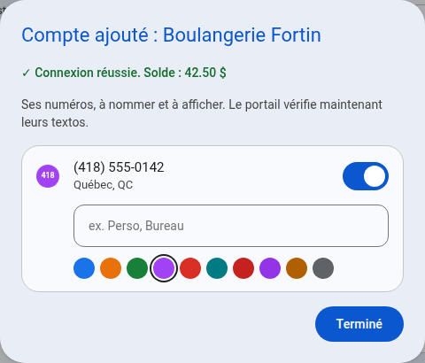
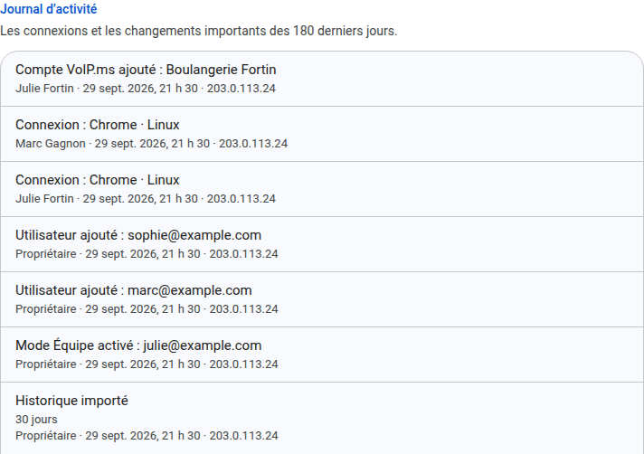

# Mode Équipe

*[English version](team.md)*

Pour un bureau, une famille, ou une agence qui gère les textos de plusieurs clients : plusieurs personnes utilisent le même portail, chacune avec son courriel et son mot de passe, et chacune voit les numéros qu'on lui donne.

Sans le mode Équipe, le portail n'a qu'un mot de passe, `APP_PASSWORD`, et qui l'a voit tout. Rien ne change tant que vous n'activez pas le mode Équipe.

## Avant de commencer

- **Il ne se désactive pas.** Une fois le mode Équipe activé, le portail y reste. Vous pouvez quand même continuer à l'utiliser seul.
- **`APP_PASSWORD` reste.** Il ouvre toujours le portail en *propriétaire*, avec *Connexion du propriétaire* sur la page de connexion, pour quand aucun administrateur ne peut se connecter. Il chiffre aussi les identifiants VoIP.ms enregistrés par l'assistant. Gardez-le secret : qui l'a peut tout faire. Le changer déconnecte tout le monde.
- **Aucun courriel n'est envoyé.** Vous créez chaque compte et donnez vous-même son mot de passe à la personne. Quand quelqu'un oublie le sien, un administrateur lui en donne un nouveau.

## 1. L'activer

1. Connectez-vous avec `APP_PASSWORD`.
2. Ouvrez *Réglages* → *Mode Équipe* → **Passer en mode Équipe**.
3. Créez le premier administrateur : un courriel, un nom et un mot de passe d'au moins 8 caractères. Ce peut être vous : vous vous connecterez alors avec ce courriel.

Dès lors, la page de connexion demande un courriel et un mot de passe.

## 2. Qui peut faire quoi

| | Propriétaire (`APP_PASSWORD`) | Administrateur | Utilisateur |
| --- | --- | --- | --- |
| Numéros visibles | Tous | Tous | Ceux qu'on lui donne |
| Envoie des textos | Avec tous les numéros | Avec tous les numéros | Avec les numéros donnés en *Lire et envoyer* |
| Utilisateurs, numéros, comptes VoIP.ms, mises à jour | Oui | Oui | Non |
| Journal d'activité | Oui | Oui | Non |
| Active le mode Équipe | Oui | Non | Non |

## 3. Ajouter des personnes

*Réglages* → *Utilisateurs* → **Ajouter un utilisateur** :

- **Courriel et nom.** Le courriel sert à se connecter.
- **Mot de passe.** Au moins 8 caractères. Donnez-le à la personne; elle peut le changer dans *Réglages* → *Mon compte*.
- **Rôle.** *Administrateur* ou *Utilisateur*.
- **Numéros**, pour un utilisateur. Pour chaque numéro : *Aucun accès*, *Lecture seule* ou *Lire et envoyer*.

Cliquez sur un utilisateur pour changer tout cela plus tard :

- **Un mot de passe oublié :** tapez-en un nouveau. Ses autres appareils sont déconnectés.
- **Accès suspendu :** la personne ne peut plus se connecter, ses appareils sont déconnectés et elle ne reçoit plus de notifications.
- **Supprimer :** la même chose, pour de bon. Ses contacts personnels partent avec elle. Les textos qu'elle a envoyés gardent son nom.

Un administrateur ne peut pas se suspendre ni se retirer le rôle d'administrateur : le portail en garde toujours un. Le propriétaire peut toujours revenir avec `APP_PASSWORD`.

## 4. Ce que voit un utilisateur

- **Ses numéros seulement.** Les conversations, résultats de recherche, images et notifications des autres numéros ne lui parviennent pas.
- **Lecture seule.** Sur un numéro qu'on lui donne en lecture seule, il lit les textos mais ne peut ni en envoyer, ni en renvoyer, ni en supprimer. Un avis remplace la zone de saisie.
- **Qui a envoyé chaque texto.** Sous chaque texto envoyé du portail : le nom de la personne (ou son courriel), *Propriétaire* ou *Vous*. Les textos envoyés d'une autre application, ou avant la 2.0, n'affichent pas de nom.
- **Ses propres réglages :** notifications, *Mes numéros*, apparence et *Mon compte* (nom, mot de passe, appareils connectés).

## 5. Numéros partagés : qui a lu quoi

Un numéro donné à plusieurs personnes a un réglage, dans *Réglages* → *Numéros* → **Lus et archives en commun** :

- **Activé (par défaut).** Une seule boîte pour tous. Une conversation qu'une personne lit est lue pour tous, et une conversation archivée l'est pour tous.
- **Désactivé.** Chacun a ses propres non-lus et ses propres archives. Quelqu'un qui reçoit le numéro plus tard commence sans aucun non-lu.

Dans les deux cas, un nouveau texto ramène une conversation archivée pour tout le monde. Quand vous réactivez le réglage, une conversation que quelqu'un a lue compte comme lue.

## 6. Mes numéros

Dans *Réglages* → *Mes numéros*, chacun choisit pour lui seul, sans rien changer pour les autres :

- **Couper les notifications** d'un numéro : plus de notifications de celui-là, les autres numéros continuent.
- **Masquer** un numéro de sa barre de numéros, de sa liste de conversations et de ses notifications. L'afficher de nouveau ramène tout. Le commutateur *Afficher* d'un administrateur, dans *Numéros*, masque plutôt un numéro pour tout le monde.

## 7. Carnets de contacts

Chaque contact appartient à l'un de ces carnets :

- **Tous les numéros :** toutes les conversations affichent son nom. Les administrateurs gèrent ce carnet.
- **Certains numéros :** seules les conversations de ces numéros affichent son nom, et seules les personnes qui voient l'un de ces numéros voient le contact. Un utilisateur peut ajouter des contacts aux carnets des numéros avec lesquels il peut envoyer.
- **Personnel :** seul son propriétaire le voit. Ses noms passent en premier dans ses conversations.

Un même numéro de téléphone peut être un contact différent dans chaque carnet : « Marie » dans le carnet du numéro *Perso*, et « Marie Tremblay (cliente) » dans celui du numéro *Bureau*.

**Après la mise à jour depuis la 1.x,** vos contacts sont dans le carnet *Tous les numéros* : tous les utilisateurs les voient. Si vos utilisateurs ne doivent pas voir les clients des autres, ouvrez chacun de ces contacts et choisissez son numéro dans *Carnet*. Un import va dans le carnet de votre choix.

## 8. Un compte VoIP.ms par client

Une agence peut ajouter un compte VoIP.ms par client : *Réglages* → *Comptes VoIP.ms* → **Ajouter un compte VoIP.ms**. Les étapes sont celles de l'assistant de configuration : l'accès API du compte, son courriel et son mot de passe API, l'adresse IP à autoriser chez VoIP.ms, puis ses numéros à nommer et à afficher. Donnez ensuite ces numéros aux utilisateurs du client.

Chaque compte peut être renommé, testé, et recevoir un nouveau mot de passe API. La réception instantanée (*Réglages* → *Réception des textos*) se règle pour le premier compte; les textos des autres comptes sont vérifiés au rythme habituel.

## 9. Le journal d'activité

*Réglages* → *Journal d'activité* montre aux administrateurs les 180 derniers jours, du plus récent au plus ancien :

- les connexions, même refusées (avec le courriel essayé), et les appareils déconnectés;
- les changements de mot de passe, et les utilisateurs ajoutés, modifiés ou supprimés;
- les changements aux numéros, aux comptes VoIP.ms et à la réception instantanée, les importations d'historique et les mises à jour;
- les conversations, messages et contacts supprimés.

Chaque ligne dit qui a agi et depuis quelle adresse IP.

## Questions

**Quelqu'un s'en va.** Suspendez son accès ou supprimez-le. Ses appareils sont déconnectés aussitôt.

**Aucun administrateur ne peut se connecter.** Utilisez *Connexion du propriétaire* avec `APP_PASSWORD`, puis donnez un nouveau mot de passe à un administrateur.

**Puis-je revenir à un seul mot de passe?** Non, mais le propriétaire peut continuer à utiliser le portail seul, et un utilisateur suspendu ou supprimé ne compte plus.

**Où sont les mots de passe?** Dans la base de données du portail, hachés en PBKDF2-SHA256, jamais en clair. Chaque connexion est une session que son propriétaire peut fermer depuis *Mon compte*.
