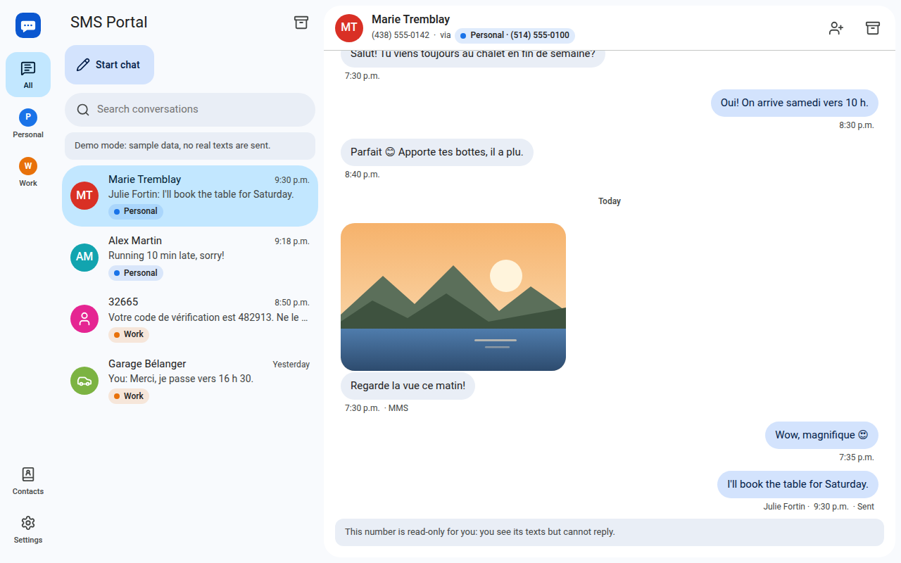
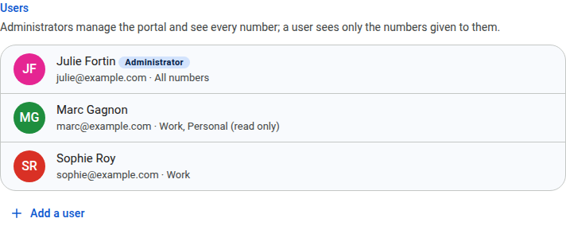
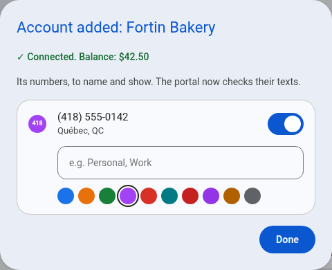
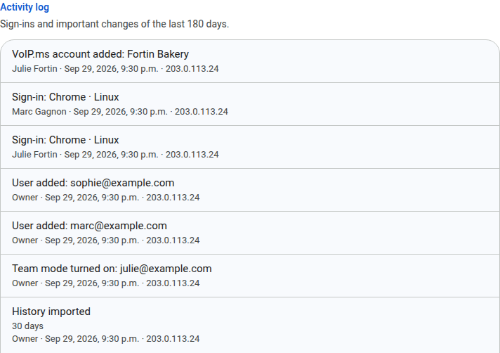

# Team mode

*[Version française](team.fr.md)*

For an office, a family, or an agency that manages the texts of several clients: several people use the same portal, each with their own email and password, and each one sees the numbers they are given.

Without Team mode, the portal has a single password, `APP_PASSWORD`, and whoever has it sees everything. That stays the way it is until you turn Team mode on.

## Before you start

- **It does not turn off.** Once Team mode is on, the portal stays in it. You can still use it alone.
- **`APP_PASSWORD` stays.** It still opens the portal as its *owner*, with *Owner sign-in* on the sign-in page, for when no administrator can sign in. It also encrypts the VoIP.ms credentials saved by the wizard. Keep it secret: whoever has it can do everything. Changing it signs everyone out.
- **No email is sent.** You create each account and give the person their password yourself. When someone forgets theirs, an administrator gives them a new one.

## 1. Turn it on

1. Sign in with `APP_PASSWORD`.
2. Open *Settings* → *Team mode* → **Turn on Team mode**.
3. Create the first administrator: an email, a name, and a password of at least 8 characters. It can be you: you will then sign in with that email.

From then on, the sign-in page asks for an email and a password.

## 2. Who can do what

| | Owner (`APP_PASSWORD`) | Administrator | User |
| --- | --- | --- | --- |
| Numbers seen | All | All | Those given to them |
| Sends texts | From every number | From every number | From the numbers given with *Read and send* |
| Users, numbers, VoIP.ms accounts, updates | Yes | Yes | No |
| Activity log | Yes | Yes | No |
| Turns Team mode on | Yes | No | No |

## 3. Add people

*Settings* → *Users* → **Add a user**:

- **Email and name.** The email is what they sign in with.
- **Password.** At least 8 characters. Give it to them; they can change it in *Settings* → *My account*.
- **Role.** *Administrator* or *User*.
- **Numbers**, for a user. For each number: *No access*, *Read only*, or *Read and send*.

Click a user to change any of it later:

- **A forgotten password:** type a new one. Their other devices are signed out.
- **Suspend access:** they can no longer sign in, their devices are signed out, and they stop getting notifications.
- **Delete:** the same, for good. Their own contacts go with them. Texts they sent keep their name.

An administrator cannot suspend or demote themselves, so the portal always keeps one. The owner can always get back in with `APP_PASSWORD`.

## 4. What a user sees

- **Their numbers only.** The conversations, search results, pictures and notifications of the other numbers do not reach them.
- **Read only.** On a number given to them read only, they read the texts but cannot send, retry, or delete any. A notice takes the place of the message box.
- **Who sent each text.** Under each text sent from the portal: the sender's name (or email), *Owner*, or *You*. Texts sent from another app, or before 2.0, show no name.
- **Their own settings:** notifications, *My numbers*, appearance, and *My account* (name, password, signed-in devices).

## 5. Shared numbers: who has read what

A number given to several people has one setting, in *Settings* → *Numbers* → **Shared read and archive**:

- **On (the default).** One inbox for everyone. A conversation one person reads is read for all, and an archived one is archived for all.
- **Off.** Each person has their own unread counts and their own archive. Someone given the number later starts with nothing unread.

Either way, a new text brings an archived conversation back for everyone. When you turn the setting back on, a conversation that someone read counts as read.

## 6. My numbers

In *Settings* → *My numbers*, each person chooses for themselves, without changing anything for the others:

- **Mute** a number: no more notifications from it, the other numbers still notify.
- **Hide** a number from their rail and their list of conversations, and from their notifications. Showing it again brings everything back. An administrator's *Shown* switch, in *Numbers*, hides a number for everyone instead.

## 7. Address books

Each contact belongs to one of these books:

- **All numbers:** every conversation shows its name. The administrators manage this book.
- **Some numbers:** only the conversations of those numbers show its name, and only the people who see one of those numbers see the contact. A user can add contacts to the books of the numbers they can send from.
- **Personal:** only its owner sees it. Its names come first in their conversations.

The same phone number can be a different contact in each book: "Marie" in the *Personal* number's book, and "Marie Tremblay (client)" in the *Work* number's.

**After updating from 1.x,** your contacts are in the *All numbers* book, so every user sees them. If your users must not see each other's clients, open each such contact and choose its number in *Address book*. An import goes to the book you choose.

## 8. One VoIP.ms account per client

An agency can add one VoIP.ms account per client: *Settings* → *VoIP.ms accounts* → **Add a VoIP.ms account**. The steps are those of the setup wizard: the account's API access, its email and API password, the IP address to allow at VoIP.ms, then its numbers to name and show. Then give those numbers to the client's users.

Each account can be renamed, tested, and given a new API password. Instant receiving (*Settings* → *Receiving texts*) is set up for the first account; the texts of the other accounts are checked on the regular schedule.

## 9. The activity log

*Settings* → *Activity log* shows the administrators the last 180 days, most recent first:

- sign-ins, refused ones too (with the email tried), and devices signed out;
- password changes, users added, changed or deleted;
- numbers, VoIP.ms accounts and instant receiving changed, history imports, and updates;
- conversations, messages and contacts deleted.

Each entry says who did it and from which IP address.

## Questions

**Someone leaves.** Suspend their access, or delete them. Their devices are signed out at once.

**No administrator can sign in.** Use *Owner sign-in* with `APP_PASSWORD`, then give an administrator a new password.

**Can I go back to a single password?** No, but the owner can keep using the portal alone, and a suspended or deleted user no longer counts.

**Where are the passwords?** In the portal's database, as PBKDF2-SHA256 hashes, never in clear. Each sign-in is a session that its owner can end from *My account*.
